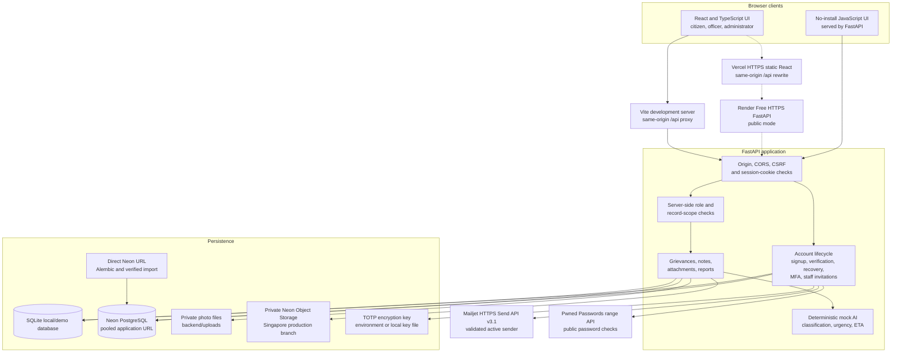

# NagrikOS architecture

This describes the implemented v4 grievance workflow with the v5 account lifecycle. React and the no-install browser UI call the same FastAPI routes. The browser does not decide which records a user may access; FastAPI enforces role and record scope before reading or changing data.

The Vite proxy is for local React development. In the planned hosted layout, Vercel serves React and rewrites `/api` to Render so the browser sees one HTTPS origin; [the deployment guide](RENDER_VERCEL_DEPLOYMENT.md) gives the exact settings. The no-install UI is served at `/` with assets under `/lite/` on FastAPI. SQLite remains the local/demo backend; PostgreSQL is selected by `DATABASE_URL` in public mode. PostgreSQL startup checks the Alembic revision and never seeds demo data. The Sydney production branch has been migrated to `20261114_01`; no startup migration runs. Runtime account email uses Mailjet HTTPS when `MAILJET_API_KEY`, `MAILJET_SECRET_KEY`, and `MAIL_FROM` are configured; one authorized message with updated credentials reached the owner's Gmail Spam folder. Photo bytes use local private files in demo mode. A configured private S3-compatible bucket uses the existing random `attachments.filename` as its object key and keeps ownership metadata in the relational table. Public uploads fail closed without durable storage, and Render startup requires the storage settings. Sydney Neon Object Storage is unavailable, so a separate Singapore Neon project now hosts the private production bucket; read-only production access passed, while production object writes remain untested.

## Trust and account flow

1. Public signup creates **citizen accounts only**. The server canonicalizes email, checks the password policy, and sends a short-lived verification link. Verification also requires the password chosen at signup. Repeating signup cannot replace pending credentials, and an active staff invitation reserves its email address.
2. Login verifies the password first. Accounts with TOTP then receive a short-lived, bounded second-factor challenge. FastAPI creates a session only after the TOTP or one-time recovery code succeeds.
3. Sessions are opaque, revocable HttpOnly cookies with a 12-hour absolute lifetime and 30-minute inactivity limit. SameSite is Strict; public mode requires Secure cookies and HTTPS. Authenticated state changes require the matching CSRF cookie and header. Expired cookies do not block public recovery, while protected routes still reject them.
4. Email verification, password reset, and staff invitations use random, expiring, single-use URL-fragment tokens stored only as hashes. Reset revokes sessions and outstanding challenges and tokens. Changing a password or disabling MFA revokes sessions; enabling MFA rotates the session.
5. Staff accounts are created through an administrator-authorized invitation after password reauthentication. The first public administrator was provisioned once through a protected GitHub environment; the one-time workflow is retired. There is no public privileged-role signup or administrator MFA-reset shortcut.

Account logic lives in [account.py](../backend/app/account.py), [auth.py](../backend/app/auth.py), and [main.py](../backend/app/main.py). The React account screens are [Login.tsx](../frontend/src/pages/Login.tsx) and [Settings.tsx](../frontend/src/pages/Settings.tsx); [account-ui.js](../backend/static/account-ui.js) and [account-settings.js](../backend/static/account-settings.js) provide the no-install equivalents. [AUTH_SECURITY_V5.md](AUTH_SECURITY_V5.md) details security controls and deployment requirements.

## Role and record boundaries

| Capability | Citizen | Department officer | Administrator |
| --- | --- | --- | --- |
| Submit a grievance | Yes | No | Yes |
| List and read grievances | Own submissions | Own department | All |
| Change priority or status; add notes | No | Own department | All |
| Route to another department | No | No | Yes |
| Assign an officer | No | Officer in the case's department | Officer in the case's department |
| Dashboard | Own submissions | Department desk | Global overview |
| Insights, department analytics, CSV export | No | No | Yes |
| Invite staff | No | No | Yes, after reauthentication |
| Reset synthetic data | No | No | SQLite demo mode only |

The backend applies citizen ownership and officer department filters in SQL queries and individual-record checks. Similar-case results, attachment access, notes, officer lists, and reports also respect these boundaries. Frontend routes mirror the permissions for navigation; they are not the authorization boundary.

## Persistence and services

| Component | Responsibility |
| --- | --- |
| `users`, `sessions`, `login_attempts` | Verified identities and roles, password and encrypted MFA state, revocable sessions, throttling |
| `account_tokens`, `auth_challenges`, `recovery_codes`, `staff_invitations` | Hashed verification/reset tokens, bounded MFA challenges, hashed one-time codes, authorized staff provisioning |
| `complaints`, `history`, `notes`, `attachments` | Grievance records, activity, follow-ups, and photo ownership metadata |
| `backend/uploads` | Local demo and read-only legacy photo bytes; access goes through FastAPI ownership and case-scope checks |
| Private S3-compatible bucket | Optional server-side photo bytes, keyed by `attachments.filename`; backend streams authorized responses, never exposes bucket URLs |
| `mail_outbox` | Retained legacy table for data preservation; no runtime writer or reader |
| `backend/app/ai.py` | Deterministic heuristic outputs for classification, urgency, ETA, and illustrative image hints; no production ML model |

SQLite migrations in [db.py](../backend/app/db.py) remain additive. PostgreSQL schema changes use [Alembic](../backend/migrations/versions/20261114_01_initial.py) over `DIRECT_URL`; the FastAPI app uses a small SQLAlchemy/psycopg pool over `DATABASE_URL`. [migrate_sqlite_to_postgres.py](../backend/scripts/migrate_sqlite_to_postgres.py) snapshots SQLite and verifies every imported row in a transaction. [NEON_POSTGRESQL.md](NEON_POSTGRESQL.md) describes setup, validation, and rollback. The conditional private storage adapter is described in [OBJECT_STORAGE_INTEGRATION.md](OBJECT_STORAGE_INTEGRATION.md); live branch and bucket verification remains pending.

## API surface

| Route group | Access and purpose |
| --- | --- |
| `/api/auth/config`, `/api/auth/signup`, `/api/auth/verify-email` | Public account entry; demo credentials appear only for loopback demo clients |
| `/api/auth/login`, `/api/auth/mfa/challenge`, `/api/auth/accept-invitation` | Password-first sign-in, second-factor completion, invitation acceptance |
| `/api/auth/forgot-password`, `/api/auth/reset-password` | Generic recovery request and token-based reset |
| `/api/auth/me`, `/api/auth/logout`, `/api/auth/security`, `/api/auth/password` | Current session and account security |
| `/api/auth/mfa/setup`, `/api/auth/mfa/enable`, `/api/auth/mfa/cancel`, `/api/auth/mfa/disable` | Authenticator enrollment, confirmation, cancellation, and removal |
| `/api/auth/staff-invitations` | Administrator only, with current-password reauthentication |
| `/api/complaints`, `/api/complaints/{id}`, `/api/complaints/{id}/notes` | Role-scoped grievance workflow |
| `/api/attachments`, `/api/attachments/{filename}` | Private photo upload and authorized retrieval |
| `/api/citizen/overview`, `/api/officer/overview` | Citizen and department dashboards |
| `/api/users/officers` | Officer directory; department-scoped for officers |
| `/api/dashboard`, `/api/insights`, `/api/departments`, `/api/export/complaints.csv` | Administrator reporting |
| `/api/ai/analyze` | Authenticated heuristic preview; similar cases filtered by role |
| `/api/health`, `/api/meta` | Public health and UI metadata |
| `/api/admin/reset-demo` | SQLite demo administrator only; unavailable with PostgreSQL |

## Runtime modes

| | Local demo | Public configuration |
| --- | --- | --- |
| Accounts | Seeds synthetic identities only for an empty database | No seeded accounts or demo credential exposure |
| Email | Mailjet HTTPS when configured; otherwise signup/recovery unavailable | Mailjet HTTPS required |
| Password screening | Local common-password blocklist | Blocklist plus breached-password range check |
| Cookies and transport | Local HTTP development settings | Secure cookies, HTTPS public URL, explicit origins, persistent TOTP key |
| API documentation | Local development access | Disabled |

`NAGRIKOS_MODE` must be set explicitly. Public startup rejects missing required configuration. These checks do not establish that any particular public hosting setup has been reviewed or deployed.
